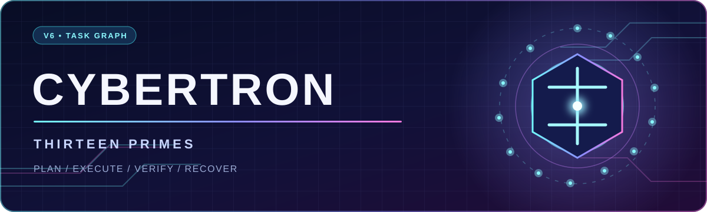
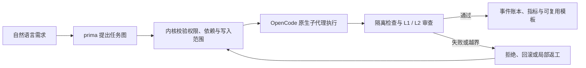

# Cybertron · Thirteen Primes

<div align="center">



[](https://github.com/zhiwenC125/Cybertron-agents/releases/tag/v0.3.0)
[](https://github.com/zhiwenC125/Cybertron-agents/actions/workflows/verify.yml)
[](pyproject.toml)
[](LICENSE)

### 十三位角色，一张可审计的任务图。

让 AI 协作从一句需求走到有边界的计划、真实工具回执、审查与可恢复的执行。

[快速安装](#-60-秒安装) · [工作方式](#-它如何工作) · [发布验收](docs/stages/I-release-030.md) · [完整文档](docs/packaging-and-installation.md)

</div>

---

## ⚡ 60 秒安装

先安装 [OpenCode V2](https://opencode.ai/) 并配置可用模型。请选择一种渠道，在**目标项目目录**运行；安装器默认只预览，加入 `--apply` 才会写入。npm 命令请勿在本仓库目录运行，以免命中本地同名包。

### npm · 无需预装 Python CLI

```bash
npx -y cybertron-agents@0.3.0 init --dry-run --project .
npx -y cybertron-agents@0.3.0 init --apply --project .
```

### pipx · Python 隔离安装

```bash
pipx install cybertron-agents==0.3.0
cybertron init --dry-run --project .
cybertron init --apply --project .
```

### GitHub Release · 可先审阅安装脚本

```bash
curl -fsSL https://github.com/zhiwenC125/Cybertron-agents/releases/download/v0.3.0/install.sh -o install.sh
bash install.sh --dry-run --project .
bash install.sh --apply --project .
```

> 想让所有项目都能选择 `prima`？将安装命令中的 `--project .` 换成 `--global`。三条渠道的包内容已经在 [0.3.0 发布验收](docs/stages/I-release-030.md)中核对。

### 启动第一项任务

```bash
opencode2 debug config
opencode2 debug agents
```

在 OpenCode 中用 **Shift+Tab** 选择 `prima`，直接输入自然语言需求；也可以在 Build 模式使用 `/cybertron <需求>`。例如：

> 修复登录接口的超时问题，补充回归测试，并说明改动影响。

首次使用时按安装器提示运行 `cybertron models setup`（npm 路径使用同包 CLI），并通过 OpenCode 的认证流程提供模型密钥。Cybertron 的模型配置只保存模型 ID，不保存 API Key。[模型配置说明 →](docs/stages/H-model-configuration.md)

---

## 🧠 它如何工作



| 能力 | 具体做法 |
| --- | --- |
| **动态规划** | `prima` 用 `cy_plan` 提交节点与依赖；内核依据十三角色注册表裁决能力和 `write_scope`。 |
| **有界执行** | 子代理拿到明确的写入范围；越界写入由 `scope_guard` 拒绝并回滚。 |
| **真实门禁** | lint、构建、测试和审查保留工具回执；实际 diff 决定不可随意降低的风险门禁。 |
| **局部恢复** | 并发写范围锁、重试与 L2 拒绝后的受影响子图重跑，避免整条流程从头开始。 |
| **持续学习** | 完成的运行可沉淀模板；事件账本生成指标与两次运行对比。 |

v6 的 M0–M5 已完成验收；真实 OpenCode 宿主中的模板复用案例将节点数从 2 减到 1、人工提问从 1 次减到 0。[查看里程碑证据 →](docs/stages/v6-progress.md)

## 🪐 两个宿主

- **OpenCode V2**：主集成路径。十三角色由 [`cybertron/registry.py`](cybertron/registry.py) 定义，配置由导出器生成；原生子代理卡片、权限、运行账本和工具回执共同构成执行证据。
- **DeepSeek Harness**：随包分发的实验性 `Cybertron v6` preset。可用 `cybertron dsh path` 找到 bundle；目前是单一 `prima` persona 与 `cy_*` 工具，尚未提供与 OpenCode 相同的十三角色子会话写范围绑定。[查看限制 →](cybertron/dsh_adapter/docs/DETAIL.md)

## 🛡️ 安全边界

- 普通角色没有直接 Shell 测试、构建或静态检查权限；检查由固定配置的隔离运行器执行。
- 真机上电、物理烧录和远程部署需明确目标、固件、擦写范围、回滚方案与人工审批；模拟审批不构成授权。
- 飞书 Wiki 正文读写由 `alpha-trion` 通过受空间约束的网关执行，凭证仅从本机环境变量读取。[配置指南 →](docs/feishu-setup.md)

完整工程约束见 [`AGENTS.md`](AGENTS.md)。

## 🧪 从源码验证

```bash
python3 -m unittest discover -s tests -v
python3 -m cybertron.stage5_verify
python3 cybertron_primes_engine.py
```

阶段 5 隔离验证依赖 macOS `sandbox-exec`。当前 0.3.0 的发布工作流、包内容比对及三条公开安装路径的结果见 [发布验收记录](docs/stages/I-release-030.md)。

## 📚 继续探索

| 想了解 | 文档 |
| --- | --- |
| 安装路径、升级与卸载 | [安装与发布方案](docs/packaging-and-installation.md) |
| v6 设计与门禁 | [动态任务图开发计划](design/DEVELOPMENT_PLAN.md) · [里程碑证据](docs/stages/v6-progress.md) |
| 0.3.0 具体变更 | [发布说明](docs/releases/v0.3.0.md) · [GitHub Release](https://github.com/zhiwenC125/Cybertron-agents/releases/tag/v0.3.0) |
| 十三角色架构背景 | [架构白皮书](design/cybertron_13_primes_architecture.md) |

---

<div align="center">

**Plan with intent. Execute with boundaries. Verify with evidence.**

MIT License · [Cybertron v0.3.0](https://github.com/zhiwenC125/Cybertron-agents/releases/tag/v0.3.0)

</div>
