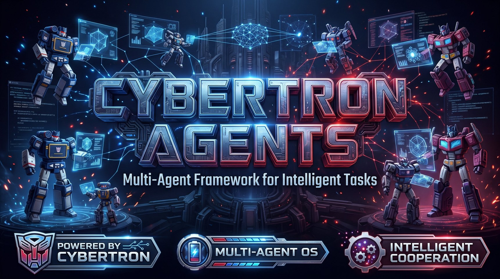
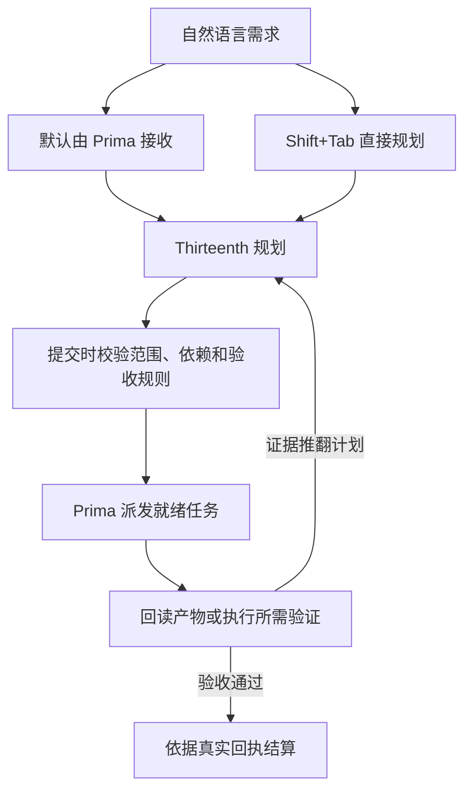

# Cybertron · Thirteen Primes

<div align="center">



[](https://github.com/zhiwenC125/Cybertron-agents/releases/tag/v0.9.0)
[](https://github.com/zhiwenC125/Cybertron-agents/actions/workflows/verify.yml)
[](pyproject.toml)
[](LICENSE)

### 十三位角色，一张可审计的任务图。

让 AI 协作从一句需求走到有边界的计划、真实工具回执、审查与可恢复的执行。

[快速安装](#-60-秒安装) · [工作方式](#-它如何工作) · [自然语言验收](docs/testing/opencode-acceptance.md) · [文档目录](docs/README.md)

</div>

---

## ⚡ 60 秒安装

先安装 [OpenCode](https://opencode.ai/) 和 Python 3.9 或更高版本，并在 OpenCode 中配置可用模型。安装器默认预览，加入 `--apply` 写入全局 OpenCode 配置。各项目保留自己的运行账本和可选模型覆盖。

### npm · 不需要全局 `cybertron` 命令

```bash
npx -y cybertron-agents@0.9.0 init --dry-run
npx -y cybertron-agents@0.9.0 init --apply
npx -y cybertron-agents@0.9.0 models setup
npx -y cybertron-agents@0.9.0 doctor --global
```

npx 只运行一次，不会留下全局 `cybertron` 命令；后续命令继续带 npx 即可。若希望直接使用 `cybertron`：

```bash
npm install -g cybertron-agents@0.9.0
cybertron --version
```

若报 `zsh: command not found: cybertron`，把 `npm config get prefix` 下的 `bin` 加入 `PATH`。

### pipx · Python 隔离安装

```bash
pipx install cybertron-agents==0.9.0
pipx ensurepath
# 重新打开终端后继续
cybertron init --apply
cybertron models setup
cybertron doctor --global
```

`pipx` 默认把可执行文件放在 `~/.local/bin`；不在 `PATH` 时先用 `~/.local/bin/cybertron` 验证。

### GitHub Release · 可先审阅安装脚本

```bash
curl -fsSL https://github.com/zhiwenC125/Cybertron-agents/releases/download/v0.9.0/install.sh -o install.sh
bash install.sh --dry-run
bash install.sh --apply
```

Shell 安装器不会修改 PATH。安装结束后使用打印出的启动器路径：

```bash
"${XDG_CONFIG_HOME:-$HOME/.config}/opencode/bin/cybertron" models setup
"${XDG_CONFIG_HOME:-$HOME/.config}/opencode/bin/cybertron" doctor --global
```

需要项目独立安装时可用 `--project .`。验证安装、核对下载摘要和升级步骤见[安装指南](docs/packaging-and-installation.md)。

### 启动第一项任务

重启 OpenCode，使用默认的 **Prima**，直接说出需求和验收条件。也可在 Build 模式运行 `/cybertron <需求>`。

> 修复登录接口的超时问题，补一个回归测试，跑过后把结果告诉我。

想先看方案时，用 **Shift+Tab** 选择 **Thirteenth**，确认方向后切回 Prima。在同一会话中，Prima 可以接续已提交的计划。[自然语言验收用例](docs/testing/opencode-acceptance.md)

`models setup` 可配置十三角色的模型编队。OpenCode 负责提供方认证，模型配置只保存模型 ID。[模型配置与排查](docs/packaging-and-installation.md#模型与首次启动)

---

## 🧠 它如何工作



明确的单文件任务可以用内容和哈希验收。软件缺陷可以用真实回归测试验收。现有结果仍有效时，同一 run 重规划会复用它们。静态检查、深度审查、测试和构建按风险及交付要求选择。[当前架构](design/cybertron_13_primes_architecture.md) · [0.9.0 验收回执](docs/testing/harness-loop-release-validation.json)

## 🪐 两个宿主

- **OpenCode V2**：主集成路径。十三角色由 [`cybertron/registry.py`](cybertron/registry.py) 定义，配置由导出器生成；原生子代理卡片、权限、运行账本和工具回执共同构成执行证据。
- **DeepSeek Harness**：随包分发的实验性 `Cybertron` preset。可用安装入口的 `dsh path` 找到 bundle（npm：`npx -y cybertron-agents@0.9.0 dsh path`；pipx：`cybertron dsh path`；Shell：`"${XDG_CONFIG_HOME:-$HOME/.config}/opencode/bin/cybertron" dsh path`）；preset 名称为 `Cybertron`；目前是单一 `prima` persona 与 `cy_*` 工具，尚未提供与 OpenCode 相同的十三角色子会话写范围绑定。[查看限制 →](cybertron/dsh_adapter/docs/DETAIL.md)

## 🛡️ 安全边界

- 测试、构建和静态检查使用绑定到任务的隔离检查，结果保留真实工具回执。
- 真机上电、物理烧录和远程部署需明确目标、固件、擦写范围、回滚方案与人工审批；模拟审批不构成授权。
- 飞书 Wiki 正文读写由 `alpha-trion` 通过受空间约束的网关执行，凭证仅从本机环境变量读取。[配置指南 →](docs/feishu-setup.md)

完整工程约束见 [`AGENTS.md`](AGENTS.md)。

## 🧪 从源码验证

```bash
python3 -m unittest discover -s tests -v
python3 -m cybertron.stage5_verify
python3 cybertron_primes_engine.py
```

阶段 5 隔离验证依赖 macOS 的 `sandbox-exec`。Node 插件测试、包校验与协作流程见[贡献指南](CONTRIBUTING.md)。

## 📚 文档

- [文档目录](docs/README.md) · [当前开发状态](DEVELOPMENT_PLAN.md)
- [安装与升级](docs/packaging-and-installation.md) · [OpenCode 自然语言验收](docs/testing/opencode-acceptance.md)
- [v0.9.0 发布说明](docs/releases/v0.9.0.md) · [历史里程碑](docs/stages/v6-progress.md)

---

<div align="center">

**Plan with intent. Execute with boundaries. Verify with evidence.**

MIT License · [Cybertron v0.9.0](https://github.com/zhiwenC125/Cybertron-agents/releases/tag/v0.9.0)

</div>
